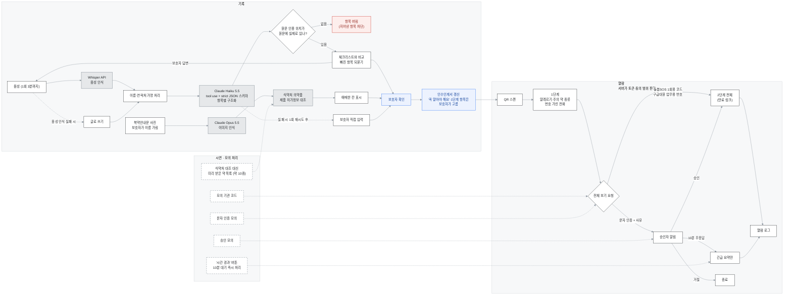

# 이음수첩 데이터 처리 파이프라인

이음수첩은 말과 사진으로 쌓고, 붙여 둔 2단계 QR로 넘기고, 보호자가 돌아오면 기록을 되돌려받는 AI 돌봄 인수인계서입니다. 아래 그림은 해커톤 MVP의 데이터 처리 흐름을 기록 · 열람 · 시연(모의) 세 레인으로 나눈 것입니다.

- AI는 정리만 하고 의료 판단은 하지 않습니다. 원문 인용 위치가 없는 항목은 저장하지 않습니다.
- 발화 정리·되묻기는 Claude Haiku 5.5, 복약안내문 인식은 Claude Opus 5.5를 씁니다.
- 비로그인 열람은 서버가 토큰과 동의 범위를 판정하고, 모든 열람을 기록합니다.
- 시연에서는 문자 인증·승인·기관 인증을 모의 처리하고 10분 대기는 '시간 경과' 버튼으로 넘깁니다.
- 음성(OpenAI)과 이름·연락처를 가린 글, 이름을 가린 사진(Anthropic)은 한국 밖에서 처리되므로 국외 이전 동의를 받습니다. 두 API 모두 입력을 학습에 쓰지 않고, 무보존(ZDR)을 신청합니다. 이음수첩 DB·파일은 서울 리전에 둡니다.

| 표시 | 뜻 |
|---|---|
| 회색 상자 | 외부 서비스 (Whisper API·Claude API는 한국 밖에서 처리, 식약처 의약품 제품 허가정보 API) |
| 파란 상자 | 보호자가 확인·선택하는 단계 |
| 점선 상자·점선 화살표 | 시연에서 모의 처리하거나 실패 시 대체하는 경로 |
| 빨간 상자 | 원문 근거가 없어 버리는 항목 |

## 이 저장소의 제출물

| 지원서 칸 | 파일 | 내용 |
|---|---|---|
| 06 기획서 | `이음수첩_기획서.pdf` | 9쪽 기획서 (원본 `ieum-proposal.html`) |
| 07 UI/UX | `ieum-wireframes.html`, `prototype/` | 화면 설계 보드, 눌러 볼 수 있는 프로토타입, 담당자 콘솔 |
| 08 유저 플로우 | `ieum-userflow.html` | 레인 5개 × 단계 5개 스윔레인 |
| 09 ERD | `ieum-erd.dbml` | MVP ERD ([dbdiagram.io에서 보기](https://dbdiagram.io/d/6afd7f0b4e0bad6598f68100)) |
| 10 파이프라인 | `README.md` | 이 문서 |

캡처 이미지(`captures/`)와 기획서 PDF는 `tools/capture.mjs`로 다시 만들 수 있습니다. (`cd tools && npm install && node capture.mjs`, Chrome 필요)
