# 이음수첩 데이터 처리 파이프라인

이음수첩은 말과 사진으로 쌓고, 붙여 둔 2단계 QR로 넘기고, 보호자가 돌아오면 기록을 되돌려받는 AI 돌봄 인수인계서입니다. 아래 그림은 기록, 열람, 인수인계 이해 확인, 시연의 처리 설계입니다. 서버와 AI 연동은 설계이며, 현재 이해 확인은 예시 데이터로 동작하는 UI 체험입니다.

```mermaid
%%{init: {"theme": "base", "flowchart": {"wrappingWidth": 400}, "themeVariables": {"fontFamily": "Pretendard GOV Variable, Pretendard GOV, Pretendard, Malgun Gothic, sans-serif", "fontSize": "15px", "primaryColor": "#FFFFFF", "primaryBorderColor": "#1E2124", "primaryTextColor": "#1E2124", "lineColor": "#8A949E", "clusterBkg": "#F7F8F9", "clusterBorder": "#CDD1D5", "edgeLabelBackground": "#FFFFFF"}}}%%
flowchart LR
  subgraph REC["기록"]
    V["음성 (1회 3분까지)"] --> STT["Whisper API<br/>음성 인식"]
    V -.->|"음성 인식 실패 시"| TXT["글로 쓰기"]
    STT --> PSE["이름·연락처 가명 처리"]
    TXT --> PSE
    PSE --> HAI["Claude Haiku 5.5<br/>tool use + strict JSON 스키마<br/>항목별 구조화"]
    HAI --> CHK{"원문 인용 위치가<br/>원문에 실제로 있나?"}
    CHK -->|없음| DROP["항목 버림<br/>(지어낸 항목 차단)"]
    CHK -->|있음| GAP["체크리스트와 비교<br/>빠진 항목 되묻기"]
    GAP -->|"보호자 답변"| V
    IMG["복약안내문 사진<br/>보호자가 이름 가림"] --> OPUS["Claude Opus 5.5<br/>이미지 인식"]
    OPUS --> MFDS["식약처 의약품<br/>제품 허가정보 대조"]
    MFDS --> FLAG["애매한 칸 표시"]
    GAP --> CONF["보호자 확인"]
    FLAG --> CONF
    CONF --> SAVE["인수인계서 갱신<br/>'꼭 알아야 해요'·1단계 항목은<br/>보호자가 고름"]
    HAI -.->|"실패 시 1회 재시도 후"| MANUAL["보호자 직접 입력"]
    MANUAL --> CONF
  end

  subgraph VIEW["열람<br/>서버가 토큰·동의 범위 판정"]
    QR["QR 스캔"] --> S1["1단계<br/>알레르기·주의 약 종류<br/>번호 가린 전화"]
    S1 --> REQ["2단계 열람 요청<br/>열람자 유형과 사유"]
    REQ --> APR["보호자 또는 대리 보호자에게 알림"]
    APR -->|승인| FULL["2단계 전체<br/>(만료 링크)"]
    APR -->|"10분 무응답"| SUM["요청 만료<br/>1단계만"]
    APR -->|거절| STOP["종료"]
    FULL --> LOG["열람 로그"]
    SUM --> LOG
  end

  subgraph UNDER["인수인계 이해 확인<br/>B5~B5e / AI 연동은 운영 설계"]
    UGATE{"허용 범위와 링크 만료 확인<br/>매 조회와 출력 직전"}
    UREAD["허용된 생활 안내 2개<br/>원문과 마지막 확인일"]
    UANSWER["내 말로 설명<br/>글 입력"]
    UCOMPARE["설명과 원문 비교<br/>부족하면 관련 항목 재검색"]
    UGROUND{"인용과 적용 범위 검증"}
    URETRY["빠진 안내만 원문으로 재안내<br/>재설명은 1회"]
    UPENDING["확인 불가면 미확인으로 남김<br/>보호자 확인 안내"]
    UDONE["확인 / 확인 필요 결과<br/>권한과 돌봄 수행을 판정하지 않음"]
    UEXPIRED["만료 시 생활 안내와 답변 제거<br/>1단계로 돌아가기"]
    UGATE -->|허용| UREAD
    UGATE -->|만료 또는 철회| UEXPIRED
    UREAD --> UANSWER --> UCOMPARE --> UGROUND
    UGROUND -->|내용 확인| UDONE
    UGROUND -->|부족한 항목| URETRY
    URETRY --> UANSWER
    UGROUND -->|"근거 없음 또는 재설명 후에도 불명확"| UPENDING
    UPENDING --> UDONE
  end

  subgraph DEMO["시연 · 모의 처리"]
    M1["식약처 대조 대신<br/>미리 받은 약 목록 (약 10종)"]
    M4["승인 모의"]
    M5["'시간 경과' 버튼<br/>10분 대기 즉시 처리"]
    M6["이해 확인 UI<br/>준비된 예시만 비교<br/>AI 분석과 저장 없음"]
  end

  SAVE --> QR
  FULL --> UGATE
  M1 -.-> MFDS
  M4 -.-> APR
  M5 -.-> SUM
  M6 -.-> UCOMPARE

  classDef ext fill:#E6E8EA,stroke:#6D7882,color:#1E2124
  classDef mock fill:#FFFFFF,stroke:#6D7882,stroke-dasharray:6 4,color:#1E2124
  classDef drop fill:#FDEEEC,stroke:#C8281E,color:#8F1D15
  classDef guard fill:#ECF2FE,stroke:#256EF4,color:#0B3D99
  class STT,HAI,OPUS,MFDS ext
  class M1,M4,M5,M6,UCOMPARE mock
  class DROP drop
  class CONF,SAVE,UGATE,UGROUND guard
```

- AI는 기록 정리와 허용 원문에 근거한 생활 안내 비교에만 사용하도록 설계합니다. 의료 판단이나 현재 복용 가능 여부를 결정하지 않습니다. 원문 인용 위치가 없는 항목은 저장하지 않습니다.
- 발화 정리·되묻기는 Claude Haiku 5.5, 복약안내문 인식은 Claude Opus 5.5를 씁니다.
- 비로그인 열람은 서버가 토큰과 동의 범위를 판정하고, 모든 열람을 기록합니다.
- 가입 문자 인증과 열람 승인은 모의 처리하고, 10분 대기는 '시간 경과' 버튼으로 넘깁니다. 2단계 열람 요청은 열람자 유형과 사유를 입력한 뒤 보호자 승인을 받는 흐름입니다.
- 음성(OpenAI)과 이름·연락처를 가린 글, 이름을 가린 사진(Anthropic)은 한국 밖에서 처리되므로 국외 이전 동의를 받습니다. 두 API 모두 입력을 학습에 쓰지 않고, 무보존(ZDR)을 신청합니다. 이음수첩 DB·파일은 서울 리전에 둡니다.

| 표시 | 뜻 |
|---|---|
| 회색 상자 | 외부 서비스 (Whisper API·Claude API는 한국 밖에서 처리, 식약처 의약품 제품 허가정보 API) |
| 파란 상자 | 보호자가 확인·선택하는 단계 |
| 점선 상자·점선 화살표 | 시연에서 모의 처리하거나 실패 시 대체하는 경로 |
| 빨간 상자 | 원문 근거가 없어 버리는 항목 |

## 인수인계 이해 확인 UI

- 제출용 프로토타입: [`prototype/app.html#/B5`](prototype/app.html#/B5). B3의 **인수인계 함께 확인**으로도 진입합니다. 생활 안내는 2단계에만 두며, B1의 1단계 정보에는 추가하지 않습니다.
- Next.js 앱: `web/`에서 `npm run dev` 후 `/care/understanding`. 홈의 체험 진입 카드에서도 열 수 있습니다.
- 흐름: B5 시작 → B5a 안내 읽기 → B5b 내 말로 설명 → B5c 빠진 항목 재안내 → B5d 결과. 재설명은 1회이며, 건너뛴 안내와 확인 불가 답변은 미확인으로 남깁니다.
- 산책 준비와 대화 시작의 가상 원문, 마지막 확인일, 준비된 답변을 사용합니다. 예시 밖의 자유 답변은 AI가 판단한 것처럼 표시하지 않습니다.
- 왼쪽 메뉴의 **시연 도구: 2단계 열람 만료**는 생활 안내와 입력을 지우고 B5e로 이동합니다. 이는 UI 예시이며 서버 접근 제어를 대신하지 않습니다.
- 브라우저 새로고침 시 답변과 결과가 초기화됩니다. 실제 보호자에게 전송하거나 DB에 저장하지 않으며, 결과로 열람 권한이나 돌봄 자격을 바꾸지 않습니다.
- 운영 연동 때는 서버에서 매 도구 호출과 최종 출력 직전에 대상자, 동의 범위, 링크 만료를 검사해야 합니다. 비교 결과는 원문 위치와 적용 버전에 연결하고 불명확하면 재안내 또는 보호자 확인으로 끝냅니다.
- 검증: `cd tools && npm run verify:understanding`. 화면 전환, 재설명, 건너뛰기, 만료, 자유 답변과 입력 안전성을 확인합니다.

## 이 저장소의 제출물

| 지원서 칸 | 파일 | 내용 |
|---|---|---|
| 06 기획서 | `이음수첩_기획서.pdf` | 9쪽 기획서 (원본 `ieum-proposal.html`) |
| 07 UI/UX | `ieum-wireframes.html`, `prototype/` | 화면 설계 보드, 이해 확인을 포함한 모바일 프로토타입 |
| 08 유저 플로우 | `ieum-userflow.html` | 레인 5개 × 단계 5개 스윔레인 |
| 09 ERD | `ieum-erd.dbml` | MVP ERD ([dbdiagram.io에서 보기](https://dbdiagram.io/d/6afd7f0b4e0bad6598f68100)) |
| 10 파이프라인 | `README.md` | 이 문서 |

캡처 이미지(`captures/`)와 기획서 PDF는 `tools/capture.mjs`로 다시 만들 수 있습니다. (`cd tools && npm install && npm run capture`, Chrome 또는 Edge 필요). B5~B5e는 각각 대표 체험 상태로 캡처합니다.
